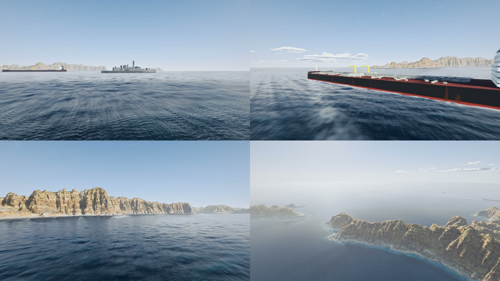

# hormuz-flight

A drone flight over the Strait of Hormuz, rendered entirely in code.

The camera flies low across the open strait past a frigate and a laden tanker, runs along the limestone cliffs of
Ras Musandam (the northern tip of Oman's Musandam peninsula), follows two patrol boats through the Fakk al Asad
channel, then climbs to a wide aerial of the island in the haze. 57.5 seconds, 1080p30, with a synthesised ocean
soundtrack.



**Watch it:** download the finished video from the [latest release](https://github.com/Moh4696/hormuz-flight/releases/latest)
(275 MB master or a 25 MB share copy).

This is a fork of [Leonxlnx/napali](https://github.com/Leonxlnx/napali) by Leon Lin
([@LexnLin](https://x.com/LexnLin)), who built the engine for his Na Pali coast flight: ray-marched terrain, GPU
erosion, an FFT ocean, volumetric clouds and the whole offline render pipeline. All of that is his work. This repo
moves the engine to a real place on the other side of the world and adds ships and sound.

## What is real and what is not

- **Real:** the coastline (OpenStreetMap) and the relief (30 m elevation tiles) of a 6.4 km square centred on
  26.3597 N, 56.5151 E. The look (pale banded limestone, bare slopes, dust haze, calm dark water) was matched by eye
  against public photographs of the Musandam coast, which are not included.
- **Procedural:** everything else. Rock detail, water, sky, haze, ships, wakes and sound are generated. There are no
  textures, images or 3D models at run time.
- **Artistic licence:** the ships are generic shapes, not specific vessels, and real tankers do not pass this close
  to the cliffs. The strait is about 39 km wide here, so the far (Iranian) shore is not modelled; it is only haze.

## What changed from the original

| Area | Change |
|---|---|
| Site | Real coastline loops and an elevation grid replace the Na Pali terrain (`hormuz_site.mjs`, `hormuz_site.json`) |
| Look | Limestone palette with dipping beds, no vegetation or beaches, a single dust-haze layer, lower sun, calmer sea |
| Ships | Two tankers, a frigate and two patrol boats as signed-distance shapes with wakes and shadows (`hormuz_ships.glsl`) |
| Flight | A new 172.5 s camera path, played back 3x (`hormuz_flight.cjs`) |
| Sound | An ocean soundscape synthesised from the scene data, no recordings (`hormuz_audio.mjs`) |
| macOS | The tools now run on Apple silicon (ANGLE Metal), not only Windows |

Every Hormuz change to the page lives in `tools/hormuz_post.cjs`, which runs as the last step of the build and
patches the generated `index.html`. The original parts are otherwise untouched.

## Run it

Open `index.html` in a recent Chrome (or any browser with WebGL2) and wait for the shaders to compile. The first
load can take 30-90 s. `index.html?mode=still` renders a single high-quality still.

The real-time view is inherited from the original and was not the focus here. Everything in this repo was checked
through the offline render tools below.

## Render the video

The tools drive headless Chrome over the DevTools protocol. They need Node 22+, Chrome and ffmpeg on the PATH.

```bash
# the whole flight in twelve crash-safe 5 s segments, then one lossless join
node tools/render_final.mjs                      # -> out/hormuz_flight_1080p.mp4

# a quick low-resolution preview: out.mp4 width height fps samples-per-frame extra-url-params
SPEED=3 node tools/video.mjs out/preview.mp4 640 360 30 1 "hud=0"

# contact sheet of single frames at the given flight times (seconds)
node tools/video.mjs --sheet sheet.png "10,40,80,120" 960 540 "hud=0"

# a still from any camera: position, yaw (0 = north), pitch, field of view
node tools/shot.mjs out.png "spp=4&hud=0&cx=-600&cy=120&cz=-900&cyaw=20&cpitch=-12&cfov=60"
```

`render_final.mjs` skips segments that already exist with the right frame count, so after a crash you just run it
again. The published video is 1,725 frames at 4 samples per frame and took 4.5 hours on an M1 Pro.

Only one render runs on the GPU at a time: `tools/cdp.mjs` holds a machine-wide lock in the temp folder.

## Sound

```bash
node tools/hormuz_audio.mjs                      # -> out/hormuz_audio.wav (48 kHz stereo)
ffmpeg -i out/hormuz_flight_1080p.mp4 -i out/hormuz_audio.wav -map 0:v -map 1:a -c:v copy \
  -af volume=4.9dB -c:a aac -b:a 256k out/hormuz_flight_1080p_sound.mp4
```

The soundtrack is filtered noise shaped by the same data as the picture. Camera height sets how much open sea you
hear, distance to the coastline sets the surf, and each ship's distance and bearing set its level and stereo
position. It prints a per-layer level table so the mix can be judged without listening. There is no music.

## Build from the parts

`index.html` is generated. Edit the parts in `tools/` and rebuild:

```bash
node tools/rebuild.cjs
```

Check the exit code. If the last step fails, `index.html` is left as the original Na Pali scene.

| File | Contents |
|---|---|
| `hormuz_post.cjs` | all Hormuz patches: site data, elevation sampling, haze, limestone, water, ship tracks, defaults |
| `hormuz_ships.glsl` | ship geometry, shading, wakes |
| `hormuz_flight.cjs` | camera path: time, position, look-at point, field of view |
| `hormuz_site.json` | baked site: coastline loops and a 213 x 213 elevation grid |
| `hormuz_site.mjs`, `coast.mjs`, `dem.mjs` | bake the site from the downloaded data |
| `hormuz_fetch.mjs` | download that data into `refs/` |
| `hormuz_audio.mjs`, `render_final.mjs` | soundtrack and segmented final render |
| `v2_template_backup.html`, `v3_*.glsl`, `v4_*.glsl`, `tweaks.cjs`, `patch_*.cjs` | the original engine parts |

To bake a different stretch of coast, change the site centre in `hormuz_site.mjs` and the bounding box and tile
range in `hormuz_fetch.mjs`, then:

```bash
node tools/hormuz_fetch.mjs
node tools/hormuz_site.mjs
node tools/rebuild.cjs
```

Most look parameters are URL knobs (see the `num('...')` calls in the page), so they can be tuned without a rebuild.

## Notes for Apple GPUs

- `pow(x, 2.)` with a negative `x` is undefined in GLSL. Direct3D folds it to `x*x`; Metal returns NaN, and the
  bloom blur smears each NaN pixel into a black block. The build rewrites every such call.
- The render server broke on folders with a space in the path. Fixed.
- Chrome is launched with ANGLE Metal on macOS and killed without Windows-only commands.

## Credits

- Engine and original flight: Leon Lin ([@LexnLin](https://x.com/LexnLin)),
  [Leonxlnx/napali](https://github.com/Leonxlnx/napali), MIT.
- Coastline: © [OpenStreetMap](https://www.openstreetmap.org/copyright) contributors, available under the Open
  Database License. `tools/hormuz_site.json` contains coastline data derived from it.
- Elevation: [Terrain Tiles](https://registry.opendata.aws/terrain-tiles/) on AWS Open Data (Mapzen), see their
  [attribution list](https://github.com/tilezen/joerd/blob/master/docs/attribution.md).
- Hormuz version built with [Claude Code](https://claude.com/claude-code). See [PROMPT.md](PROMPT.md).

## License

[MIT](LICENSE)
